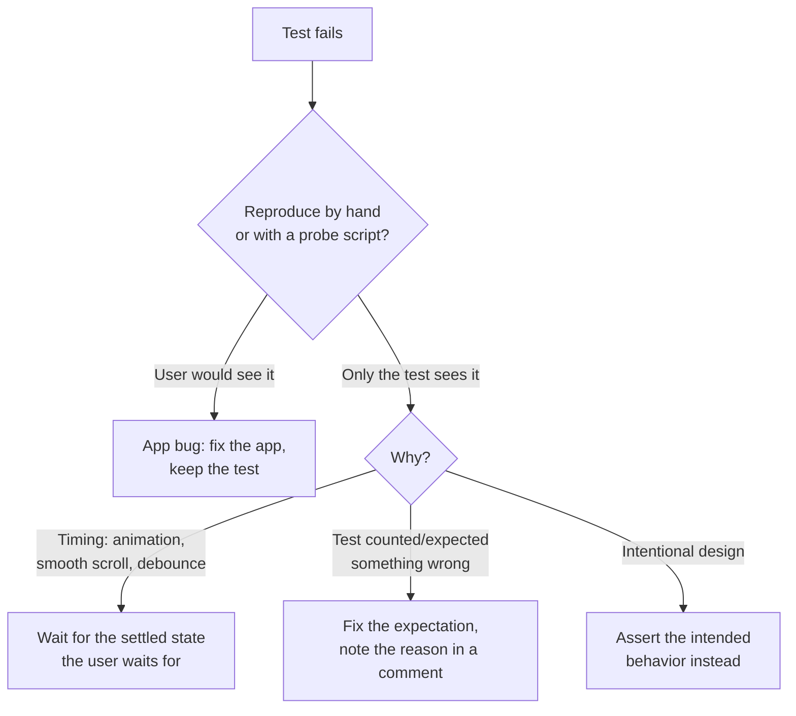

# ui-testing — test every detail, and prove it

## Overview

Split UI testing into seven layers, drive every one of them from fixed data, and finish with a measured coverage report so gaps are listed rather than guessed.

## Usage

Use this skill when:
- Someone asks to test a UI, write browser/E2E tests, or "check all the details".
- A UI was just built or redesigned and needs a regression net before it changes again.
- A user reports a UI bug (a wrong highlight, a colour, a broken state): write the failing test first, then fix.
- Tests exist but nobody knows what they miss, or they are flaky.

Read this file fully, then load references as each step needs them.

## Core Concepts

| # | Layer | Catches | Tool |
|---|---|---|---|
| 1 | **Deterministic fixtures** | nothing by itself; makes every other layer repeatable | pinned date + captured API snapshot + route mocks |
| 2 | **Behavior tests** | broken interactions | Playwright, one test per interaction |
| 3 | **State matrix** | missing / broken states | matrix file + mocks that force each state |
| 4 | **Visual regression** | the "wrong border colour" class of bug | `toHaveScreenshot` per theme × viewport |
| 5 | **Accessibility + keyboard** | contrast, labels, focus, unreachable controls | `@axe-core/playwright` + a Tab walk |
| 6 | **Measured coverage** | untested code paths | V8 JS coverage → `scripts/coverage-report.mjs` |
| 7 | **Strict console** | silent JS errors | fixture that fails any test with a console error |

Three principles run through all of them:

- **Assert what a user would notice:** which item is highlighted (`aria-current`), what is expanded (`aria-expanded`), what text appears, what is disabled, whether the page scrolls sideways. Do not assert implementation details such as internal state or class names that carry no meaning.
- **Mock at the network boundary.** The app runs for real; only its API responses are faked. This reaches states the real backend can rarely produce (slow load, 500, empty, 10,000 items, hostile HTML) without touching app code.
- **A small number of real round-trips.** Keep one serial spec that talks to the real backend (with credentials-free/offline settings) to prove the mocks match reality.

## Workflow

Copy this checklist and tick it off:

```
- [ ] 1. Inventory regions + controls → state matrix
- [ ] 2. Deterministic fixtures (pinned date, snapshot, mocks)
- [ ] 3. Scaffold the suite
- [ ] 4. Write specs, layer by layer
- [ ] 5. Run → triage every failure (app bug vs test bug)
- [ ] 6. Coverage loop until the uncovered list is only impossible branches
- [ ] 7. Stability gate: 3 consecutive green runs
```

### 1. Inventory → state matrix

You **MUST** list every data region and every interactive control before writing a test, because the matrix is what makes gaps visible. Copy `assets/state-matrix.md` into the project and fill it in: one row per region (empty / loading / error / populated / edge) and one row per control (rest / hover / pressed / focus-visible / disabled / busy). Each cell later names the test that covers it; an empty cell is a gap.

Next step: build the fixtures that make each cell reachable.

### 2. Deterministic fixtures

You **MUST** remove every source of non-determinism before the first assertion, because a test that depends on today's date, live data or a paid API will flake or cost money:

1. **Pin the clock.** Give the app a "today" override (env var such as `APP_TODAY=YYYY-MM-DD`, or `page.clock.setFixedTime()` for client-only dates).
2. **Capture one realistic snapshot** of the main API payload from a real run (`curl .../api/<main> > e2e/fixtures/<name>.json`). Real content exposes layout bugs that lorem ipsum hides.
3. **Offline backend.** If the app calls paid services (LLMs, payment APIs), the test server **MUST** run with a fake/offline provider, because every CI run would otherwise spend money.
4. **Mocks per state.** Each test clones the snapshot and mutates it (`d.items = []`, a 200-char title, `status: 500`, a 1.5 s delay). See `assets/fixtures.ts` → `mockApi()` and `mockJob()`.

Next step: scaffold.

### 3. Scaffold

Run `scripts/scaffold.sh <project-dir>`. It creates `e2e/` with the config, fixtures, coverage report and matrix, and installs `@playwright/test` and `@axe-core/playwright`. Then edit `e2e/playwright.config.ts`: the `webServer.command` that starts the app in its deterministic mode, the port, and `APP_SCRIPT_MATCH` (which script URLs count toward coverage).

Requirements: Node 20+ (Playwright refuses older versions) and Google Chrome installed (`channel: "chrome"` avoids downloading browsers).

Next step: write the specs.

### 4. Write the specs

Write one spec file per layer, in this order. Patterns and code for each are in `references/layer-patterns.md`; load it now.

| Spec | Must contain |
|---|---|
| `states.spec.ts` | every matrix region cell: populated, empty, slow-load skeleton, no-flash on fast load, error + retry, long text (truncates, no sideways scroll), huge numbers, hostile HTML (shown as text, never executed, no `javascript:` links), missing optional fields |
| `interactions.spec.ts` | every control: its effect, its request body, its busy state (spinner, `aria-busy`, other job buttons locked), its failure (error toast, controls unlock), validation without a request |
| `navigation.spec.ts` | each nav item highlights exactly itself, deep links/hash, scroll-tracking hand-off, highlight survives re-render |
| `theme-a11y.spec.ts` | default theme, toggle persists, axe scan per theme + expanded state + each screen, Tab walk with visible focus ring on every stop, hover/pressed/disabled/busy computed styles differ, reduced motion |
| `visual.spec.ts` | full page per theme × viewport, plus key panels in interesting states |
| `flows.spec.ts` | serial, desktop only: a few real round-trips + server guards |

You **SHOULD** tag specs that matter on small screens `@responsive` and run them in a mobile project too (the config does this via `grep`).

Next step: run and triage.

### 5. Run → triage

```bash
cd e2e && npx playwright test --update-snapshots   # first run creates baselines
npx playwright test                                # every later run compares
```

For every failure you **MUST** decide which side is wrong before changing anything, because "fixing" a test to match a real bug hides the bug:



Debug with a throwaway probe spec that prints measurements (counts, `scrollY`, computed styles, contrast ratio), then delete it. Real examples of each branch are in `references/triage-examples.md`.

Next step: measure coverage.

### 6. Coverage loop

```bash
rm -rf .coverage && npx playwright test && node coverage-report.mjs
```

The report prints function and code coverage of the app's own scripts and every function / code span no test executed. For each uncovered item: write the missing test, or record why it is unreachable. Repeat until only impossible fallbacks remain. Uncovered spots are where bugs hide — the keyboard-scroll bug in `references/triage-examples.md` was found this way.

Next step: prove stability.

### 7. Stability gate

You **MUST** run the full suite three times in a row without `--update-snapshots` and verify that three runs give identical green results before reporting done, because one green run doesn't prove a suite is stable.

## Rules for assertions

- You **MUST NOT** use fixed sleeps to wait for app behavior — use web-first assertions (`toBeVisible`, `expect.poll`) because sleeps are either flaky or slow. The one exception is waiting out a human-paced pause the test simulates (e.g. letting a smooth scroll finish before the user scrolls again); comment it.
- Every screenshot and axe scan **MUST** run on the settled UI (entrance animations done), because mid-fade elements have genuinely low contrast and unstable pixels. Wait in the shared `open()` helper, not in each test.
- You **SHOULD** prefer role/label locators (`getByRole("button", { name })`) because they also prove the control is accessible; fall back to stable ids/data attributes.
- You **MUST NOT** update visual baselines to make a failure go away without looking at the diff image, because that bakes the regression in. Baselines change only with an intended design change.
- A test that deliberately triggers a 4xx/5xx **MUST** opt out of the strict console explicitly (`allowConsoleErrors(testInfo)`), so every other test still fails on stray errors.

## Common mistakes

| Mistake | Fix |
|---|---|
| Counting focusables with `offsetParent !== null` | Content of a closed `<details>` keeps a layout box in Chrome but is not tabbable; exclude `details:not([open]) *` except `summary` |
| axe or screenshot right after `goto` | Wait for the entrance animation / first-paint class to clear in `open()` |
| Wheel/keyboard scroll immediately after a click that smooth-scrolls | The browser finishes the programmatic scroll; wait for it as a person would |
| Asserting `cursor: not-allowed` on a busy button | Busy and disabled are different states; assert each one's intended style |
| One shared server for parallel tests that mutate state | Mutating specs run `serial` in one project; all others mock the API |
| Baselines generated on macOS, compared on Linux CI | Baselines are per-OS (`-darwin.png`); generate them in the CI image too |
| Coverage of the whole page including vendor bundles | Filter to the app's own scripts with `APP_SCRIPT_MATCH` |
| `page.reload()` inside a test | Chrome drops coverage for the page being left, so code that ran before the reload is reported as never run; use the fixtures' `reload(page)`, which saves coverage first |
| Theme stored under a generic `localStorage` key | Old builds' preferences leak in; test with a stale key pre-seeded |

## Ship gate

- [ ] Every state-matrix cell names a passing test (or a written reason it can't happen)
- [ ] No console errors anywhere except explicitly allowed ones
- [ ] axe: zero WCAG 2.1 AA violations in every theme and screen
- [ ] Tab walk: every visible control reachable, each with a visible focus ring
- [ ] Visual baselines for each theme × viewport, reviewed by eye once
- [ ] Coverage report: uncovered list contains only unreachable fallbacks
- [ ] Three consecutive green runs
- [ ] README lists how to run, update baselines and read coverage

## Scope boundaries

- Designing or building the UI → `vibe-ui`. Its state matrix and ship gate are what this skill verifies.
- Charts and data viz styling → `dataviz`; test them here like any other region.
- Backend unit tests stay in the project's own test runner; this skill covers the browser.

## Files

| File | Use |
|---|---|
| `scripts/scaffold.sh` | create `e2e/` in a project and install dependencies |
| `assets/playwright.config.ts` | desktop + mobile projects, webServer, Chrome channel, screenshot tolerance |
| `assets/fixtures.ts` | strict console, JS coverage capture, `mockApi`, `mockJob`, `open`, `reload`, `expectNoHorizontalOverflow` |
| `scripts/coverage-report.mjs` | merge coverage, print %, list untouched functions and code |
| `assets/state-matrix.md` | regions × states and controls × states template |
| `references/layer-patterns.md` | copy-ready test patterns for every layer |
| `references/triage-examples.md` | real failures, which side was wrong, and the fix |
